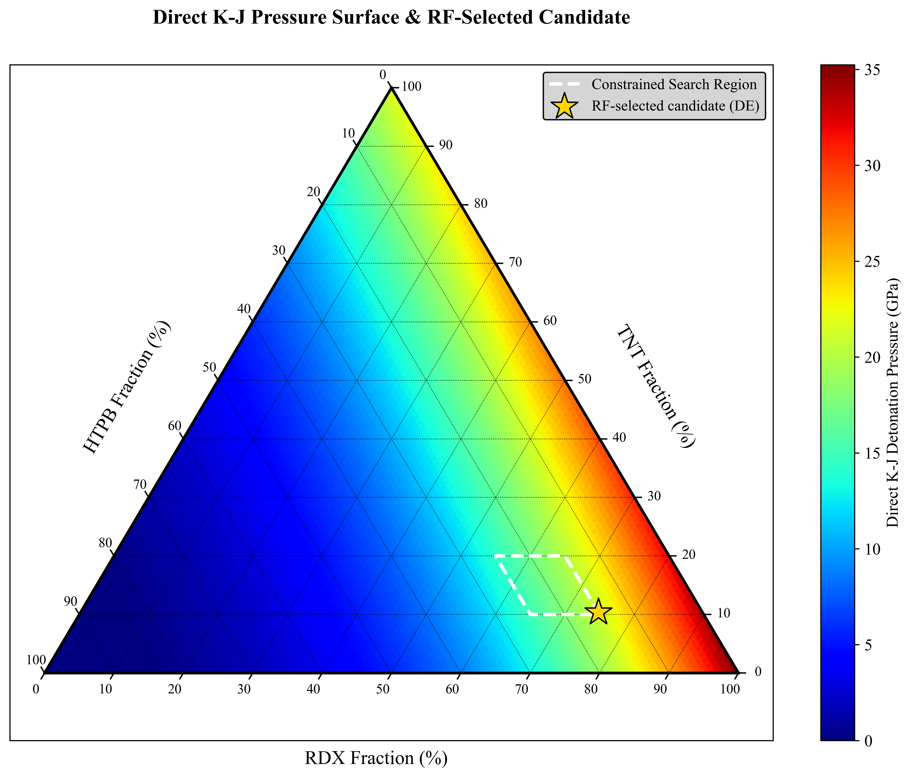
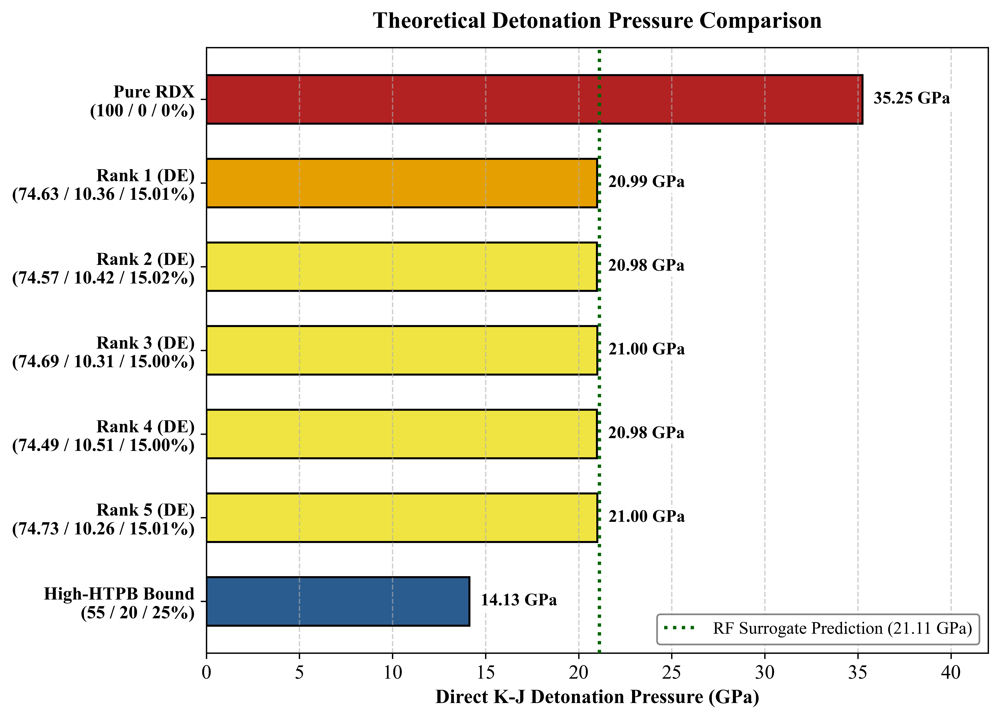
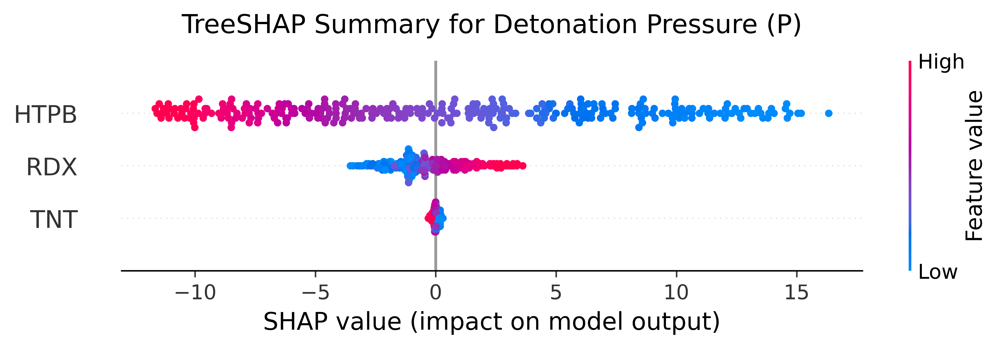

# Random-forest Heuristic Optimizer (RHO) for RDX/TNT/HTPB Formulations

[](https://www.mdpi.com/journal/processes)
[](https://www.python.org/)
[](LICENSE)

Official computational framework, execution logs, and 600 DPI publication visualization scripts accompanying the research article:

> **AI-Assisted Surrogate Modeling and Optimization of RDX/TNT/HTPB Formulations Using Thermochemical Simulations: A Surrogate Topology and Budget-Controlled Benchmark**  
> Yılmaz Mert, Metin Zontul, Seda Karateke\*, and Mehmet Akif Cifci  
> *Processes* (MDPI), 2026 — Special Issue: *Advances in Machine Learning and Hybrid Modeling for Chemical Processes*

---

## Overview

Formulation screening for polymer-bonded explosives (PBXs) requires navigating constrained compositional spaces while accounting for the topological interaction between surrogate response surfaces and optimization algorithms. This repository implements the **Random-forest Heuristic Optimizer (RHO)** workflow for ternary **RDX / TNT / HTPB** formulations:

1. **Thermochemical Simulation (`K–W / K–J`):** Generates theoretical detonation pressure ($P$, GPa) and velocity ($D$, m/s) across **1,500 Dirichlet-sampled full-simplex compositions** ($\alpha = (1,1,1)$) and an **independent 300-sample local validation set** strictly inside the operational domain ($10\text{--}20\%$ TNT, $15\text{--}25\%$ HTPB).
2. **Surrogate Modeling (`RF` vs. `MLP` vs. `Ridge`):** Evaluates predictive fidelity globally and locally (`n_estimators=100`, `max_depth=15`, `random_state=42`).
3. **Topology- & Budget-Controlled Optimization (`NFEV <= 1000`):** Benchmarks **Differential Evolution (`polish=False`)**, **Dual Annealing**, and **Basin-Hopping** (including local-search ablations) across **30 independent seeds** on both the **piecewise-constant RF surface** and the **smooth continuous MLP surface**.
4. **Multi-Candidate K–J Verification & TreeSHAP XAI:** Verifies the Top-5 distinct DE candidates directly against the Kamlet–Jacobs equations and quantifies feature attributions across the closed compositional simplex.

---

## Key Quantitative Findings

### 1. Global vs. Local Surrogate Fidelity
| Model | Target | Evaluation Domain | $R^2$ | MAPE (%) | MAE |
| :--- | :--- | :--- | :---: | :---: | :---: |
| **Ridge Regression** | Pressure | Global Test ($n=300$) | 0.9285 | 82.31 | 1.75 GPa |
| **Ridge Regression** | Pressure | Local Constrained ($n=300$) | -1.4910 | 13.38 | 2.41 GPa |
| **MLP Neural Network** | Pressure | Global Test ($n=300$) | 0.9997 | 1.91 | 0.09 GPa |
| **MLP Neural Network** | Pressure | Local Constrained ($n=300$) | 0.9992 | 0.21 | 0.04 GPa |
| **Random Forest (RHO)** | Pressure | Global Test ($n=300$) | 0.9994 | 1.77 | 0.13 GPa |
| **Random Forest (RHO)** | Pressure | Local Constrained ($n=300$) | 0.9945 | 0.56 | 0.10 GPa |
| **Random Forest (RHO)** | Velocity | Global Test ($n=300$) | 0.9995 | 0.78 | 26.93 m/s |
| **Random Forest (RHO)** | Velocity | Local Constrained ($n=300$) | 0.9949 | 0.21 | 14.32 m/s |

### 2. Surrogate Topology & Budget-Controlled Benchmark (30 Runs, `NFEV <= 1000`)
* **Smooth MLP Surface:** All solvers converge deterministically to the exact constrained boundary corner (**75.00% RDX, 10.00% TNT, 15.00% HTPB**) at **$21.09 \pm 0.00\text{ GPa}$**.
* **Piecewise-Constant RF Surface:** Under strict derivative-free settings (`polish=False`), **DE** achieves **$21.03 \pm 0.09\text{ GPa}$** with the lowest average runtime (**138.2 ms/run**, mean `NFEV = 935.7`), statistically matching Dual Annealing ($21.06 \pm 0.08\text{ GPa}$, $p = 0.110$) and Nelder–Mead Basin-Hopping ($21.06 \pm 0.08\text{ GPa}$, $p = 0.106$).
* **Top-Ranked Formulation & Direct K–J Verification:** The top-ranked DE candidate (**74.63% RDX, 10.36% TNT, 15.01% HTPB**) yields an RF-predicted pressure of **21.11 GPa** and a direct K–J pressure of **20.99 GPa** (**7194.10 m/s**). All **Top-5 distinct DE candidates** remain tightly bounded between **20.98 and 21.00 GPa**.

---

## Visual Highlights

### Ternary Detonation Pressure Landscape & Optimal Candidate (Figure 4)
<p align="center">
  
</p>

### Direct Kamlet–Jacobs Verification of Top-5 Candidates (Figure 5a)
<p align="center">
  
</p>

### TreeSHAP Feature Attributions for Detonation Pressure (Figure 6)
<p align="center">
  
</p>

---

## Repository Structure

```text
RHO-Explosive-Design/
├── README.md
├── requirements.txt
├── src/
│   ├── Logs.txt
│   ├── PBX_RHO_optimizer.py
│   ├── plot_parity_RF_surrogate.py
│   ├── plot_cv_boxplots.py
│   ├── plot_ternary_contour.py
│   └── plot_thermochemical_barcharts.py
└── Figures/
    ├── Figure2a_Detonation_Pressure_Parity.png
    ├── Figure2b_Detonation_Velocity_Parity.png
    ├── Figure3_CV_Boxplots.png
    ├── Figure4_Ternary_Plot.png
    ├── Figure5a_Detonation_Pressure.png
    ├── Figure5b_Detonation_Velocity.png
    ├── Figure6_SHAP_Pressure_Robust.png
    └── Figure7_SHAP_Velocity_Robust.png
```

---

## Quick Start & Reproducibility

All scripts reside inside `src/` and read `Logs.txt` from the same directory to guarantee exact numerical consistency across logs, tables, and 600 DPI figures:

```bash
git clone https://github.com/metinzontul/RHO-Explosive-Design.git
cd RHO-Explosive-Design
pip install -r requirements.txt

cd src
# 1. Run full simulation, optimization benchmark, and TreeSHAP analysis
python PBX_RHO_optimizer.py > Logs.txt

# 2. Regenerate all 600 DPI publication figures
python plot_parity_RF_surrogate.py
python plot_cv_boxplots.py
python plot_ternary_contour.py
python plot_thermochemical_barcharts.py
```

---

## Citation

If you use this code or benchmark dataset in your research, please cite:

```bibtex
@article{Mert2026RHO,
  author  = {Mert, Y{\i}lmaz and Zontul, Metin and Karateke, Seda and Cifci, Mehmet Akif},
  title   = {AI-Assisted Surrogate Modeling and Optimization of RDX/TNT/HTPB Formulations Using Thermochemical Simulations: A Surrogate Topology and Budget-Controlled Benchmark},
  journal = {Processes},
  year    = {2026},
  note    = {Manuscript ID: processes-4701050}
}
```